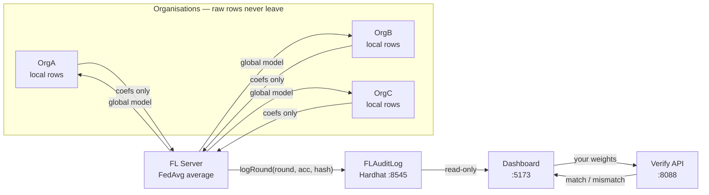

# FedLedger — Complete Reference (in simple words)

> **What this file is:** the whole project explained twice — first as an idea
> you can say out loud, then as code you can point at. If you understand this
> file, you can answer any viva question on FedLedger.
>
> Short version first: **three organisations train one shared model without
> sharing their data, and every round is sealed into a blockchain record that
> anyone can independently re-check.**

---

## Part 1 — The theory (no code yet)

### 1.1 The problem: learning together without showing your data

Imagine three hospitals that all want a better disease-prediction model.
Hospital A's patient records can't leave Hospital A — privacy law, ethics,
common sense. Same for B and C. But a model trained on all three hospitals'
data would beat any model trained on just one.

This is the exact tension federated learning resolves: **learn from
everyone's data while moving nobody's data.**

### 1.2 Federated learning in five lines

1. Each organisation trains the **same model shape** on its **own private rows**.
2. Each sends only the **learnings** (model weights — plain numbers) to a server. No patient rows, no records, nothing recoverable.
3. The server **averages** the three learnings into one global model (this averaging is called **FedAvg**).
4. The server sends the global model **back to all three**.
5. Repeat. Every round, the shared model gets smarter, and no raw row ever crossed a wire.

### 1.3 FedAvg with a tiny example

Suppose each hospital's model learned a single number, and each hospital had
these many patients:

| Hospital | Patients | Learned number |
|----------|----------|----------------|
| A        | 50       | 0.50           |
| B        | 50       | 0.70           |
| C        | 50       | 0.60           |

The global number is the **patient-weighted mean**:

```
global = (50×0.50 + 50×0.70 + 50×0.60) / 150 = 0.60
```

A hospital with more patients pulls the average harder — that weighting is
the whole "weighted" in weighted average. The real project does this over
thousands of numbers (a coefficient matrix + intercept vector) instead of
one, but the idea is identical.

### 1.4 Why a blockchain: the register written in ink

Averaging needs trust: how do you know the server really averaged, instead
of inventing numbers? FedLedger answers with a **blockchain audit trail**.

Think of a school attendance register: the teacher writes each day's entry
in ink. There is no whitener in the room and pages can't be torn out. Anyone
can later read any day's entry, and nobody — not even the teacher — can
rewrite history.

`FLAuditLog` (our smart contract) is that register. After every round it
stores: **round number, accuracy, participants, a fingerprint of the model,
timestamp, who logged it.** There is deliberately **no edit and no delete
function** — immutability here isn't a promise, it's the absence of any
button that could break it.

### 1.5 Hashing: the fingerprint

A **hash** turns any data into a short fixed fingerprint. Two properties
make it audit-grade:

- **Same input → same fingerprint, always.** So a recomputed average that
  matches proves the same model.
- **One digit different → totally different fingerprint.** Change a single
  coefficient by 0.0001 and the fingerprint is unrecognisable. There is no
  "almost matches".

Example (real SHA-256):

```
SHA-256("hello") = 2cf24dba5fb0a30e26e83b2ac5b9e29e1b161e5c1fa7425e73043362938b9824
```

Each round, the project hashes the averaged weights and seals that
fingerprint on-chain (technically SHA-256 first, then one keccak wrap for
chain-side comparison — the Verify tab shows you both layers). Anyone holding
any weights file can re-fingerprint it and compare. That is the entire
"don't trust, verify" idea.

### 1.6 The trust model in one paragraph

Nobody trusts anybody here, and nobody has to. Nodes don't trust each other
(they never see each other's rows). Everyone could distrust the server — so
the server's every output is fingerprinted into a register it cannot edit,
and **anyone can recount the average independently**. Trust is replaced by
arithmetic anyone can redo.

---

## Part 2 — How one round works (follow the numbers)

Dataset used in the demo: **iris** — 150 flowers, 4 measurements, 3 species,
split evenly so OrgA/OrgB/OrgC hold ~50 rows each.

| Step | What happens | Example |
|------|--------------|---------|
| 1. Train | Each org fits logistic regression on its own 50 rows | 3 local models |
| 2. Send | Each ships only its updated numbers: 3×4 coef matrix + 3 intercepts = **15 floats, 0 rows** | OrgA → server, then OrgB, then OrgC |
| 3. Aggregate | Server takes the patient-weighted mean (FedAvg) | one global model |
| 4. Evaluate | The global model is sent back and scored on each node's own held-out 20%, then averaged | e.g. 93.3% |
| 5. Seal | Round number + accuracy + weight fingerprint written to FLAuditLog | permanent record |
| 6. Distribute | Global model returns to all three nodes | next round's starting point |

Accuracy therefore climbs across rounds (a real run went
50% → 80% → 90% → … → 93–96%): the shared model genuinely learns.

---

## Part 3 — The program tour (same story, as code)

### 3.1 Folders: who does what

| Folder / file | Job, simply |
|---|---|
| `run_fedledger.py` | One-command starter: builds the dashboard, starts Hardhat, deploys the contract, starts dashboard + FL server + 3 nodes + verify server, opens the browser |
| `fl_nodes/node.py` | One script plays all three orgs (`--node 1/2/3`): trains locally, sends only weights |
| `fl_server/server.py` | The warden: collects updates, runs FedAvg, scores the global model, seals the round, writes the JSON files the dashboard reads |
| `fl_server/fedavg.py` | The averaging math + the fingerprint function |
| `fl_server/blockchain_logger.py` | The bridge: Python talking to the contract (log a round, read a round, compare a hash) |
| `blockchain/contracts/FLAuditLog.sol` | The ink register (77 lines, no edit/delete anywhere) |
| `app/dashboard_server.py` | Serves the dashboard on `:5173` + a **read-only** chain proxy (the browser can never write to the chain through it) |
| `app/verify_server.py` | Tiny API on `:8088`: takes weights, recomputes the fingerprint, compares with on-chain |
| `app/web/` | The React dashboard (4 tabs) |
| `data/` | Splits a dataset into 3 private partitions + describes the dataset |
| `tests/` | Proves the math, the logging, and the hashing |
| `scripts/` | Screenshot tool; `outputs/` holds the tab screenshots |

### 3.2 The three JSON files (with examples)

**`app/round_results.json`** — the run's scoreboard, one array per round:

```json
[[1, 88.9, "0x4f2a…ba09"], [2, 91.7, "0xd2e5…1210"], [3, 93.3, "0x0"]]
```

`[round, accuracy %, transaction hash]`. A hash of `"0x0"` means that round
never reached the chain — it still counts as a round, it just holds no
chain record.

**`app/global_weights.json`** — the actual averaged numbers, keyed by round:

```json
{"1": [[[-0.385, 0.814, -1.975, -0.923], [0.457, ...]], [0.245, 1.109, -1.354]]}
```

`{round: [coef_matrix, intercept_vector]}`. This is the file that makes a
**match** possible on the Verify tab — it holds the exact arrays the chain
fingerprinted.

**`data/dataset_meta.json`** — describes the dataset (`iris`, 150 samples,
4 features, 3 classes), so the UI states real row counts instead of
hardcoded ones.

### 3.3 The two functions everything rests on

Averaging (`fl_server/fedavg.py`) — the weighted mean from §1.3, over
arrays instead of single numbers:

```python
global_coef = (100/300)*w1_coef + (80/300)*w2_coef + (120/300)*w3_coef
```

Fingerprinting (same file) — the numbers become lists, lists become text,
text becomes SHA-256:

```python
weights_as_list = [x.tolist() for x in global_weights]
hex_string = hashlib.sha256(json.dumps(weights_as_list).encode()).hexdigest()
```

Verifying (`fl_server/blockchain_logger.py`, via `POST :8088/verify`) repeats
that fingerprint on *your* weights and compares with the stored one:

```json
{ "match": true }
{ "match": false }
{ "match": false, "error": "...", "code": "not_found" }
```

A missing round answers 404 ("gap"), never 500 — **missing is not fraud.**

### 3.4 Running it

```bash
python run_fedledger.py            # full 10-round run, opens the dashboard
python run_fedledger.py --rounds 5 # shorter run
```

Services started (all on your own machine, nothing leaves it):

| Service | Port | Job |
|---|---|---|
| Dashboard | `:5173` | the 4 tabs + JSON files + read-only chain proxy |
| Hardhat chain | `:8545` | the blockchain itself (in-memory — restarting wipes it) |
| Flower server | `:8080` | coordinates the training rounds (internal) |
| Verify API | `:8088` | hash comparison for the Verify tab |

Logs land per process in `logs/` (`fl-server.log`, `node1/2/3.log`,
`hardhat.log`, `dashboard.log`, `verify.log`, `verify-server.log`).

---

## Part 4 — What each tab does (the exam story, short version)

Three friends (Sharma, Verma, Iyer) prepare for one exam. Nobody shows their
notes to anyone. A strict warden averages their formula sheets, writes every
round in an ink register, and allows recounts.

- **Tab 1 — Overview: the notice board.** Which exam (dataset), how many
  students, the rules, what each tab is for, both JSON formats documented,
  and the three checkable claims (rows never leave · records are permanent ·
  models are re-checkable) plus honest limits (what is *not* recorded).
- **Tab 2 — Federation: the group study, replayed.** One round in five
  phases — train → send → aggregate → seal → distribute. Formula sheets
  travel one friend at a time; the master sheet returns to all three at
  once. Speed slider, Auto/Full/Still motion, every arrow labelled with what
  crosses it.
- **Tab 3 — Ledger: the warden's register.** Every round as a row (round,
  accuracy, receipt hash, status); click a row for the full on-chain receipt
  (block, gas, timestamp); the accuracy curve on the side. Nothing claimed,
  only displayed — missing shown as missing.
- **Tab 4 — Verify: the revaluation form.** Pick a chain record, supply
  weights three ways (the run's own saved file → must **match**; an invented
  demo file → must **mismatch**; nudge one digit of the real file →
  **mismatch**), press Compare. The verdict always comes with both hash
  values as evidence, and on demo/snapshot data the tab says the result is
  not evidence about the shown run.

---

## Part 5 — The viva demo (60 seconds, two files)

1. Verify tab → pick an index → **load live weights** → Compare → green
   **match**. *"The run's own file agrees with the chain."*
2. **Load the demo file** → Compare → red **mismatch**. *"An invented file
   disagrees — verification really runs, it doesn't just say yes."*
3. Closing line: *"Nobody shared their notes, everyone shared their
   learnings, everything is written in ink, and anyone can demand a recount."*

---

## Part 6 — Honest limitations (say these before ma'am asks)

- The chain is **local and in-memory**: restart Hardhat and history vanishes. Perfect for a demo, not a deployment claim.
- Accuracy is the mean of three **local** held-out scores, not one common test set — shared model, separate exam papers.
- Only **logistic regression** on small tabular datasets (iris → digits scale).
- `global_weights.json` is a deliberate convenience so a match is demoable; a stranger would recompute FedAvg themselves instead.
- Participants are stored on-chain but the dashboard doesn't display them (Solidity omits `string[]` from the public getter).

---

## System map


